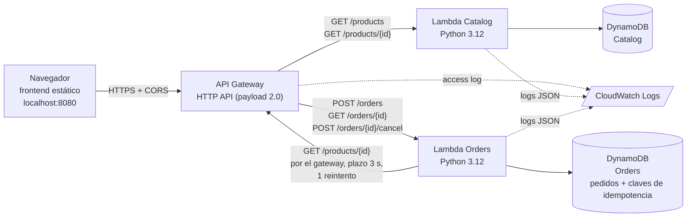

# Arquitectura

| Componente | Responsabilidad | Datos propios |
|---|---|---|
| Frontend | Menú, carrito, `Idempotency-Key`, pedidos guardados en `localStorage`. Sin credenciales. | Solo IDs de pedido en el navegador |
| API Gateway | Punto de entrada público, enrutamiento, CORS, access log | Ninguno |
| Catalog | Productos y disponibilidad | Tabla Catalog |
| Orders | Crear, consultar y cancelar pedidos; idempotencia; cálculo de precios | Tabla Orders |

Orders **no** lee la tabla Catalog: pide cada producto a Catalog por HTTP a través del gateway.

## Flujo de `POST /orders`
1. Orders busca la clave `IDEMP#<key>`. Si existe: mismo fingerprint → devuelve el resultado original (200); distinto → 409.
2. Si no existe, consulta cada producto en Catalog (plazo total 3 s, 1 reintento). Fallo o timeout → 503 sin crear nada.
3. Calcula precios y total en el servidor y escribe pedido + clave en **una transacción** de DynamoDB (201).
4. Si pierde la carrera contra otra petición con la misma clave, relee el registro y responde como replay.

Limitación: el rol `LabRole` es compartido por las dos funciones en este despliegue (ver `evidence/security.md`).
